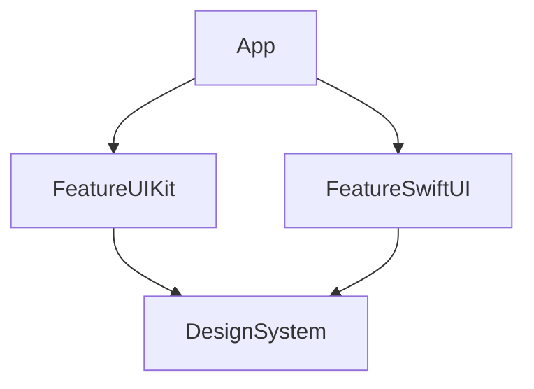

# Plan

## Objetivo
Proyecto demo iOS que muestre una estrategia de calidad en PRs: SwiftLint, unit tests y snapshot tests, con aprobación explícita de cambios visuales.

## Prerequisitos
- Xcode 27.1 (versión fija, documentada en `.xcode-version` y seleccionada explícitamente en el workflow de CI). Se acepta usar la versión en public preview de los runners de GitHub: los jobs con Xcode usan el runner `xcode-27`, que trae Xcode 27.1 y el runtime iOS 27.0. Si faltara el runtime, el workflow lo instala (`xcodebuild -downloadPlatform iOS`).
- Deployment target: iOS 15.6.
- mise como gestor de herramientas. Versiones fijadas en `.mise.toml`:
  - tuist
  - swiftlint
- Simulador de referencia fijo para los snapshots: iPhone 17 con iOS 27.0 en CI (`SIMULATOR_OS=27.0`). En local el `Makefile` usa iOS 27.2 por defecto (variables `SIMULATOR_NAME` y `SIMULATOR_OS`); los snapshots locales pueden diferir de los de CI, por lo que los de referencia se generan en CI.

## Proyecto
### Arquitectura modular (Tuist)
El proyecto es modular. Se crean 3 módulos de ejemplo, cada uno como framework independiente:

| Módulo | Contenido | Depende de |
| --- | --- | --- |
| `DesignSystem` | Componentes y estilos compartidos (colores, tipografías, vistas reutilizables en UIKit y SwiftUI). | - |
| `FeatureUIKit` | Flujo de ejemplo en UIKit (p. ej. lista + detalle) con `UIViewController`. | `DesignSystem` |
| `FeatureSwiftUI` | Flujo de ejemplo en SwiftUI (p. ej. formulario o login) con `View` y `ViewModel`. | `DesignSystem` |

La app `App` es solo el contenedor: depende de `FeatureUIKit` y `FeatureSwiftUI` y los expone desde un punto de entrada simple.

Convenciones:
- Los módulos se definen en `Project.swift` (o con helpers en `Tuist/ProjectDescriptionHelpers`) para evitar duplicar configuración.
- Cada módulo tiene sus propios targets de pruebas:
  - `<Modulo>Tests` (unit tests).
  - `<Modulo>SnapshotTests` (snapshot tests), separado de los unit tests para poder ejecutarlos por separado.
- Los snapshots viven dentro de cada módulo (`__Snapshots__/`), de modo que un cambio queda acotado al módulo afectado.
- Dependencia `swift-snapshot-testing` (pointfreeco) vía Tuist/SPM, solo para los targets de snapshots.
- Las dependencias entre módulos son unidireccionales: los features no dependen entre sí.
- El `.xcodeproj` / `.xcworkspace` generado no se versiona (`.gitignore`).

### Flujos de ejemplo
- Flujo UIKit en `FeatureUIKit` y flujo SwiftUI en `FeatureSwiftUI`.
- Lógica de presentación separada de la vista para poder probarla con unit tests.

### Pruebas
- Cada módulo tiene sus unit tests y snapshot tests.
- Unit tests: lógica de ViewModels/presenters.
- Snapshot tests, por cada pantalla o componente (`DesignSystem` incluye sus componentes):
  - Estados clave (cargando, contenido, error, vacío).
  - Light y dark mode.
  - Un solo tamaño de dispositivo (el del simulador de referencia) y un tamaño grande de Dynamic Type.
  - Escala de imagen fija en 1x (independiente del simulador) para mantener los archivos pequeños; la escala se define en `Shared/SnapshotSupport`.
  - Comparación con `precision: 1` y `perceptualPrecision: 0.98`: no se tolera ningún píxel distinto en cantidad, solo pequeñas diferencias de color por antialiasing.
  - Sin contenido no determinista (fechas, animaciones, red): datos fijos y dependencias inyectadas.
- Los snapshots de referencia se guardan en `__Snapshots__/` dentro del repo.
- Por defecto los tests nunca graban: un snapshot ausente o distinto hace fallar la prueba. La grabación solo ocurre de forma explícita (`make snapshots-record`).

### Calidad de código
- SwiftLint con `.swiftlint.yml` (reglas habilitadas, excluir `Derived/` y `Tuist/`).
- En CI se ejecuta con `--strict`.

### Makefile
Único punto de entrada, usado igual en local y en CI:

| Target | Acción |
| --- | --- |
| `make bootstrap` | `mise install` + `tuist install` |
| `make generate` | `tuist generate --no-open` |
| `make lint` | SwiftLint (`--strict`) |
| `make test-unit` | Unit tests |
| `make test-snapshot` | Snapshot tests (verificación) |
| `make snapshots-record` | Regenera los snapshots de referencia |
| `make test` | `test-unit` + `test-snapshot` |

## GitHub
### Checks obligatorios en cada PR
Workflow `pr-checks.yml` con jobs independientes (marcados como *required* en la protección de rama):
- `lint`: SwiftLint.
- `unit-tests`: unit tests.
- `snapshot-tests`: snapshot tests.

Buenas prácticas del workflow:
- Runner macOS con versión fija y Xcode seleccionado explícitamente.
- Caché de mise y de SPM/Tuist.
- `concurrency` con `cancel-in-progress` por PR.
- `.xcresult` e imágenes de diferencia subidos como artefactos cuando falle un job.

### Estrategia de snapshots
`@renzocastroyape` es revisor obligatorio mediante `CODEOWNERS` sobre `**/__Snapshots__/**`, con la regla de protección de rama "Require review from Code Owners". GitHub lo solicita solo cuando cambian snapshots.

Casos:
1. **El autor subió snapshots nuevos o modificados**
   - `snapshot-tests` verifica que coincidan con el render actual.
   - El diff de imágenes aparece en el PR y lo aprueba `@renzocastroyape`.
2. **El autor cambió la UI pero no subió snapshots**
   - `snapshot-tests` falla y publica como artefacto los diffs.
   - El job `update-snapshots` (en `pr-checks.yml`) regenera los snapshots en el runner, los verifica y hace commit a la rama del PR. Comenta en el PR la lista de archivos y relanza los checks.
   - El diff de imágenes aparece en el PR ("Files changed") y lo aprueba `@renzocastroyape`, igual que en el caso 1. No se puede mergear sin esa aprobación (Code Owners).
   - Si el revisor no aprueba el cambio, el autor corrige la UI o revierte el commit de snapshots.

Reglas:
- Los snapshots solo se generan con el simulador y Xcode fijados (idealmente en CI) para evitar diferencias por entorno.
- Un snapshot actualizado por el bot no llega a la rama principal sin la aprobación del revisor (Code Owners sobre `__Snapshots__/`).
- El job de actualización usa permisos mínimos (`contents: write`, `pull-requests: write`, `actions: write`), solo corre en eventos `pull_request` de ramas del mismo repositorio, y el relanzamiento de checks es un `workflow_dispatch` (sin evento `pull_request`), lo que evita bucles.

## Entregables
1. Proyecto Tuist modular con 3 módulos de ejemplo (`DesignSystem`, `FeatureUIKit`, `FeatureSwiftUI`) y la app contenedora.
2. Configuración de SwiftLint.
3. Unit tests y snapshot tests por módulo, con sus snapshots de referencia.
4. `Makefile`, `.mise.toml`, `.gitignore`.
5. Workflow de GitHub (`pr-checks.yml`, con el job `update-snapshots`) y `CODEOWNERS`.
6. `README.md` breve: instalación, ejecución de pruebas, grabación de snapshots y flujo de aprobación.